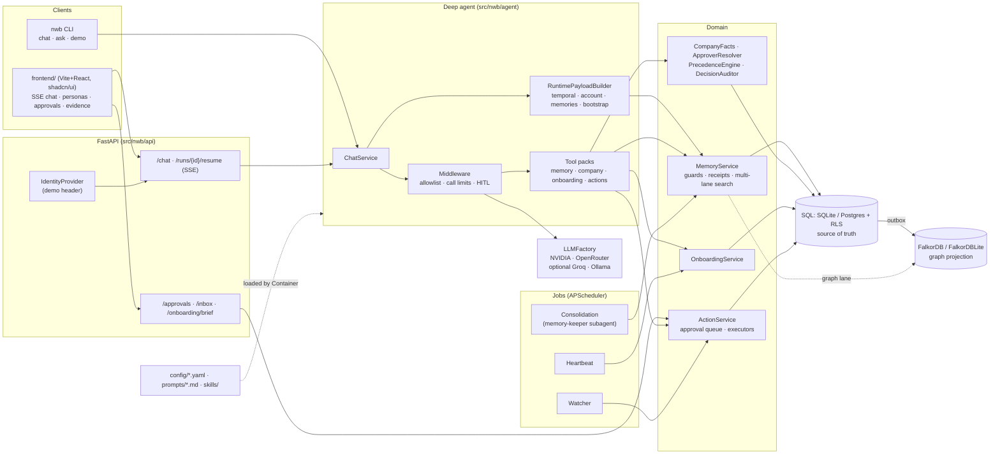
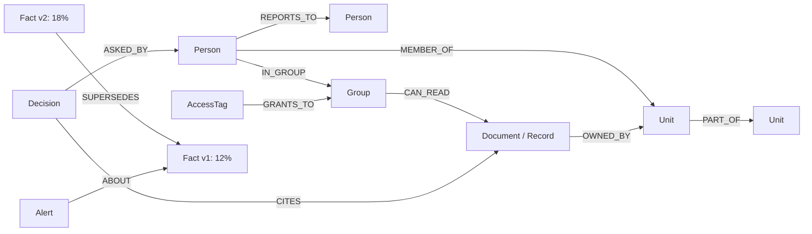

# Northwind Brain (Company Brain)

A company brain on FalkorDB: it answers what the company knows, as of a given date, only from what the person asking may see, with every answer traced back to the graph node and Cypher it came from, and it acts only after a human approves.

Demo video: https://youtu.be/KGmLJPeKAZQ

FalkorDB Graph Hacks entry for all three tracks:
- **Track 1, Agents That Act on Connected Data:** the heartbeat watcher reads the graph and the onboarding records (overdue items, stale facts), resolves the right approver, and proposes an action that runs only after that person clicks Approve.
- **Track 2, Agent Memory and Coordination:** organisational memory in access-tiered FalkorDB graphs plus per-user memory in its own FalkorDB graph, carried across sessions, curated by a memory-keeper subagent whose changes go through approval.
- **Track 3, Company Brain:** a company knowledge graph with access tiers, time-aware facts and cited answers, with an evidence ledger for every answer.

All data is synthetic, and every LLM it uses is on a free tier.

## The problem

Northwind Consulting is a synthetic consultancy of 3,002 people. All of its data is synthetic, produced by the scripts in `generator/` for a fictional company. What it knows is scattered across documents, tickets, chats, HR records and approvals. Not everyone may see everything: a finance lead can read a pricing exception that a junior consultant must not. And the truth changes over time: a draft said a 12% discount for Brightmart, the approved version says 18%.

A plain RAG assistant fails here in three ways:
- **It leaks.** It retrieves whatever is most similar, whoever is asking.
- **It goes stale.** It cannot tell the draft from the approved version, or say what was true on a given date.
- **It forgets.** Each session starts from zero, and nothing records why an answer was given.

## Thesis

Most teams treat memory as storage: embed it, retrieve it, call it context. It breaks the moment the context has an owner. Personal memory is about you. Organisational memory is about what a company knows, who is allowed to know it, and which version was true when. Same word, different data, different failure modes, and I stopped looking for one clever graph to rule them all. So now I build the organisational layer: what an agent should remember, who it answers to, and how you trace a decision back to its evidence.

## What Company Brain does

The demo personas live in `demo/personas.yaml`; the scripted run is `docs/DEMO.md`, checked end to end by `scripts/demo_ui_check.py`.

1. **Siddharth asks "What discount did we finally approve for Brightmart?"** and gets 18%, the approved figure rather than the 12% draft, with a citation chip. The Evidence tab shows the tier, the FalkorDB graph, the node, the Cypher, and a small reasoning graph from question to answer.
2. **Nikhil asks the same question** and is refused. The answer gives no hint of the figure or of where it lives, because the facts he cannot see are never retrieved.
3. **Omkar, a new hire,** gets a day-N onboarding plan built from HR records: his manager, his buddy and his open items.
4. **The heartbeat spots overdue onboarding.** The watcher finds Omkar's overdue items, resolves his manager Alok as the approver, and queues an escalation. Nothing is sent until Alok clicks Approve in his inbox.
5. **Claire Bennett, an external auditor,** sees only what has been explicitly granted to her. An external person is never merged with an internal one (`config/resolution.yaml`).

## How it solves it, layer by layer

### a. Ingestion and connectors
- `nwb load-layer1` / `nwb load-layer2` (`src/nwb/ingest/layer1.py`, `layer2.py`) load the org, people, groups, access rules, records, documents, grants and facts into SQL, then `nwb graph-sync` projects the SQL outbox into FalkorDB (`src/nwb/db/outbox.py`, `src/nwb/graph/projection.py`). Every projection is batched with `UNWIND` and uses `MERGE`, so replays are idempotent.
- Documents become a knowledge graph through GraphRAG-SDK with a reviewed ontology (`config/ontology.json`, `src/nwb/kg/ontology.py`, `src/nwb/kg/load.py`).
- Entity resolution (`src/nwb/kg/resolution.py`, `config/resolution.yaml`) merges only exact matches. A probable duplicate becomes a suggestion in the approvals inbox; no model merges anything on a guess.
- Connected apps are entries in `config/sources.yaml`, each served by one read-only subagent (`src/nwb/connectors/`).

### b. Three access-tiered graphs and per-item access
- Company knowledge is split across one FalkorDB graph per access level, named `{company}_kb_{level}` (`config/graph.yaml`, `src/nwb/conf/models.py`): `nw_kb_internal`, `nw_kb_confidential` and `nw_kb_highly_confidential`. Classification levels and source tags are in `config/classification.yaml`; an unknown tag fails closed to the most sensitive level.
- Inside a tier, per-item access is explicit: `(:AccessTag)-[:GRANTS_TO]->(:Group|:Person)` and `(:Group|:Person|:Unit)-[:CAN_READ]->(:Record|:Document)`, with people and units loaded from a SCIM-style directory export (`src/nwb/ingest/layer1.py`).
- `src/nwb/access/visible.py` computes the record and document ids a person may read as of a date; fact reads are filtered to those source ids.

### c. Time-aware facts
- Facts are `(:Fact)` nodes with two clocks: `valid_at` / `invalid_at` (when it was true) and `recorded_at` (when we learned it) (`src/nwb/temporal/graph_facts.py`).
- A newer fact points at the one it replaces with `SUPERSEDES` or `OVERRIDES`; the old node stays with `invalid_at` set, so an as-of question about an earlier date still reads it. Nothing is deleted. Conflicts raise an `(:Alert)` linked with `ABOUT`.
- Precedence (which source wins) is decided when the fact is written; as-of reads are plain Cypher.

### d. The access layer and Postgres row-level security
- Every request carries who is asking and as of when; the demo `IdentityProvider` (`src/nwb/identity.py`) supplies the person. *Where the request comes from (network or device context) is designed, not yet live.* The demo identity header is not real authentication.
- SQL is the source of truth. On Neon Postgres the runtime connects as the limited `nw_app` role, and row-level security scopes rows per person and per company (`migrations/*.pg.sql`, e.g. `0004_rls.pg.sql`, `0017_user_scope_rls.pg.sql`, `0022_owner_assumes_app_role.pg.sql`; `src/nwb/db/app_role.py`). Migrations run as the owner on a separate direct connection.

### e. Agent runtime and model routing
- A Deep Agent (`src/nwb/agent`) with tool packs for memory, company knowledge, onboarding and actions; middleware for a tool allowlist, call limits and human-in-the-loop interrupts; subagents (`agent/subagents/*.md`: researcher, auditor, memory-keeper) and skills with progressive disclosure (`agent/skills/*/SKILL.md`).
- Models are chosen only by env (`LLM_MAIN`, `LLM_BACKGROUND`, `LLM_GRAPH`): NVIDIA NIM first, then OpenRouter's free Nemotron, falling back only on 429, 5xx, timeouts and connection failures (`src/nwb/llm/`). See [Which model each caller uses](#which-model-each-caller-uses).

### f. The evidence ledger
- Every fact an answer uses carries the graph it came from, the node label and the exact Cypher `MATCH` that found it (`src/nwb/temporal/graph_facts.py`, `Fact.with_(graph=..., node_label=..., query=...)`).
- Answers at or above `confidential` also write a `(:Decision)` audit node, `ASKED_BY` the person and `CITES` the sources (`src/nwb/graph/projection.py`, `audit_answers_at_or_above` in `config/classification.yaml`).
- The UI (`frontend/`) shows numbered citation chips, and its Evidence tab draws the reasoning graph: question, graph searched, nodes read, answer, each with its source and Cypher.

### g. Memory: two homes, a gate and a keeper
- **Organisational memory** is the company graphs above. **Per-user memory** is a separate FalkorDB graph per person through Graphiti, with group id `{company}__{user}`, e.g. `nw__nw1101` (`src/nwb/memory/graphiti_memory.py`). Personal memory is owner-only (`config/memory.yaml`).
- **The write gate** (`src/nwb/memory/guards.py`, rules in `config/memory.yaml`) rejects anything that looks like a secret, venting, self-corrections, stack traces and pasted error dumps.
- **The memory keeper** (`src/nwb/jobs/consolidate.py`, `agent/subagents/memory-keeper.md`) runs after a set number of user turns and at session end. It processes conversation windows oldest first; adds go through, while patches and removals become approvals. *Refusing a change whose target memory has moved on since it was proposed is designed, not yet live.*
- **Learn from edits** (`src/nwb/memory/edit_learning.py`): when a person edits an approval draft, the change is phrased as a directive for next time.
- **Copy-before-drop migrations** (`src/nwb/db/copy_before_drop.py`, `src/nwb/memory/sql_copy.py`): before a migration drops a table, its rows are copied out and counted, so nothing is lost silently.

### h. Heartbeat, watcher and the approvals inbox
- The heartbeat (`src/nwb/jobs/heartbeat.py`, `config/heartbeat.yaml`) sends quiet onboarding nudges. The watcher (`src/nwb/jobs/watcher.py`) applies rules such as `overdue_onboarding` (items overdue by `min_days_overdue`+ days) and files one deduplicated escalation per person per week.
- Actions (`src/nwb/actions/service.py`, `config/actions.yaml`) go to the resolved approver: the manager or the resource owner. In chat, `propose_action` pauses the run before the tool executes; the human approves or rejects through `POST /runs/{id}/resume`. Inbox approvals go through `POST /approvals/{id}/decide`. Nothing runs without a person.
- `nwb serve --scheduler` runs heartbeat, watcher and consolidation sweeps on APScheduler.

### i. Observability and logging
- All logging goes through `src/nwb/obs/log.py`: structured events plus `dataflow(Hop.X, ...)`, one trace event per hop of a request (API, session, agent run, retrieval, SQL write, outbox, LLM call).

## Why FalkorDB is essential

FalkorDB is not a side index here. Take it away and these features stop working:
- **Company facts and as-of answers.** Facts live only in the per-tier FalkorDB graphs; the SQL `facts` table is dropped after its rows are copied (`migrations/0019_drop_facts.pg.sql`). Every as-of lookup, supersession and conflict alert is Cypher in `src/nwb/temporal/graph_facts.py` (`GraphFactBook`, wired in `src/nwb/container.py`).
- **Access tiers.** The separation between `nw_kb_internal`, `nw_kb_confidential` and `nw_kb_highly_confidential` is one FalkorDB graph per level (`config/graph.yaml`, `src/nwb/conf/models.py`); a tier the person can't see is a graph that is never queried.
- **Document knowledge retrieval.** Company search runs GraphRAG-SDK `retrieve` over the FalkorDB knowledge graph, including the SDK's text-to-Cypher path when `enable_cypher` is on (`src/nwb/kg/retrieve.py`, built by `src/nwb/kg/load.py`).
- **Per-user memory.** Personal memory is a Graphiti graph per user on FalkorDB (`src/nwb/memory/graphiti_memory.py`, `FalkorDriver`); the SQL memory tables are dropped after copy (`migrations/0018_drop_sql_memory.pg.sql`).
- **The evidence ledger.** Each cited fact carries its FalkorDB graph name, node label and the Cypher `MATCH` that found it (`src/nwb/temporal/graph_facts.py`), which is what the UI's Evidence tab and reasoning graph show. Decision audit nodes with `ASKED_BY` and `CITES` edges are written to the graph (`src/nwb/graph/projection.py`).

SQL stays the source of truth for the org, people, grants and onboarding plans, and is projected into FalkorDB through the outbox (`nwb graph-sync`).

## Architecture



HITL flow: when the model calls `propose_action`, LangGraph pauses before the tool runs and the client gets an
`interrupt` event. The human then approves or rejects through `POST /runs/{id}/resume`, and the same run continues.
Actions from the watcher go into the queue for the resolved approver (the manager or the resource owner), who
decides through `POST /approvals/{id}/decide`. Approved actions run through a configured executor.

## Graph data model

Labels and relationships from `src/nwb/graph/schema.py`, `src/nwb/graph/projection.py`, `src/nwb/temporal/graph_facts.py` and `config/graph.yaml`. Every label has an index on `id`; `MEMBER_OF`, `IN_GROUP`, `REPORTS_TO` and `CAN_READ` are indexed on `from`.

| Label | Key properties |
|---|---|
| `Company` | `id`, `name` |
| `Unit` | `id`, `name`, `kind`, `company_id`, `valid_from`, `valid_to` |
| `Person` | `id`, `name`, `title`, `grade`, `location`, `status`, `external`, `hired_on` |
| `Group` | `id`, `name` |
| `AccessTag` | `id` (source tag), `cls`, `share` |
| `Record` (plus a type label) / `Document` (plus a source label) | `id`, `cls`, `share`, `tag`, `personal`, `hash`, `source`; records add `type`, `occurred_at`; documents add `title`, `doc_type`, `version` |
| `Fact` | `id`, `key`, `about`, `value`, `scope`, `src_id`, `src_type`, `authority`, `status`, `valid_at`, `invalid_at`, `recorded_at` |
| `Alert` | `id`, `type`, `detail`, `recorded_at` |
| `Decision` | `id`, `tool`, `asof`, `owner` |
| `Client`, `Topic`, `PolicyFamily` | what a fact is about |

| Relationship | Meaning |
|---|---|
| `(Unit)-[:PART_OF]->(Unit)` | org hierarchy |
| `(Person)-[:MEMBER_OF {from, to, role, leadership, primary}]->(Unit)` | membership over time |
| `(Person)-[:REPORTS_TO {from, to}]->(Person)` | reporting line over time |
| `(Person)-[:IN_GROUP {from, to}]->(Group)` | group membership |
| `(AccessTag)-[:GRANTS_TO]->(Group or Person)` | who a tag opens to |
| `(Group, Person or Unit)-[:CAN_READ {from, until, relation}]->(Record or Document)` | per-item grant |
| `(Record or Document)-[:OWNED_BY]->(Unit)`, `-[:OWNED_BY_PERSON]->(Person)` | ownership, used to resolve approvers |
| `(Fact)-[:SUPERSEDES or OVERRIDES or CONTRADICTS]->(Fact)` | version history, never deleted |
| `(Alert)-[:ABOUT]->(Fact)` | conflict or staleness alert |
| `(Decision)-[:ASKED_BY]->(Person)`, `(Decision)-[:CITES]->(Document, Record or Person)` | answer audit |

Graphs: `nw_kb_internal`, `nw_kb_confidential`, `nw_kb_highly_confidential` (company knowledge and facts per tier) and one Graphiti graph per user, `nw__<person id>` (personal memory). The GraphRAG-SDK ontology (`config/ontology.json`) adds `Allocation`, `ApprovalLimit`, `Exception`, `HrCase`, `Training`, `Person` and `Unit` entities with `ALLOCATED`, `FOR_PERSON`, `MEMBER_OF` and `REPORTS_TO` relations.



## Cypher the product depends on

1. **As-of fact lookup** (`src/nwb/temporal/graph_facts.py`, `_window` + `_rows`): the fact that was true on a date, in this scope, from sources the person may read; highest authority first.
```cypher
MATCH (f:Fact)
WHERE f.key = $key AND f.about = $about AND f.status IN $statuses
  AND f.valid_at <= date($asof) AND (f.invalid_at IS NULL OR f.invalid_at >= date($asof))
  AND f.scope = $scope AND f.src_id IN $src
RETURN f.id, f.key, f.value, ... ORDER BY f.authority DESC, f.valid_at DESC, f.id LIMIT 8
```
2. **Supersede without deleting** (`src/nwb/temporal/graph_facts.py`, `_relate` and the invalidate step): link the new fact to the old one and close the old one's window.
```cypher
MATCH (f:Fact {id: $id}) MATCH (o:Fact {id: $old}) MERGE (f)-[e:SUPERSEDES]->(o)
MATCH (f:Fact {id: $id}) SET f.invalid_at = date($end), f.status = 'superseded'
```
3. **Reporting line projection** (`src/nwb/graph/projection.py`, `ReportingLineProjector`): the time-bounded manager edges that onboarding and approver resolution rely on.
```cypher
UNWIND $rows AS r MERGE (p:Person {id: r.person_id}) MERGE (m:Person {id: r.manager_id})
MERGE (p)-[e:REPORTS_TO {from: date(r.valid_from)}]->(m) SET e.to = ..., e.src = r.src_id
```
4. **Per-item grants** (`src/nwb/graph/projection.py`, `GrantProjector`): who can read which record or document, and for how long.
```cypher
UNWIND $rows AS r MERGE (s:Group {id: r.subject_id}) MERGE (n:Document {id: r.resource_id})
MERGE (s)-[g:CAN_READ {id: r.id}]->(n)
SET g.from = date(r.valid_from), g.until = ..., g.relation = r.relation
```
5. **Decision audit** (`src/nwb/graph/projection.py`, `DecisionProjector`): record who asked and what the answer cited.
```cypher
UNWIND $rows AS r MERGE (d:Decision {id: r.id}) SET d.tool = r.tool, d.asof = date(r.asof), d.owner = r.person_id
WITH d, r MATCH (p:Person {id: r.person_id}) MERGE (d)-[:ASKED_BY]->(p)
UNWIND $rows AS r MATCH (d:Decision {id: r.id}) UNWIND r.cites AS src
MATCH (n) WHERE (n:Document OR n:Record OR n:Person) AND n.id = src MERGE (d)-[:CITES]->(n)
```
6. **Conflict alert** (`src/nwb/temporal/graph_facts.py`): flag a contradiction against the fact it is about.
```cypher
MERGE (a:Alert {id: $id}) SET a.type = $type, a.detail = $detail, a.recorded_at = $recorded
WITH a MATCH (f:Fact {id: $fid}) MERGE (a)-[:ABOUT]->(f)
```

Per-user memory reads and writes go through Graphiti's search and episode APIs on the user's own FalkorDB graph (`src/nwb/memory/graphiti_memory.py`). The watcher's overdue check reads the onboarding plan from SQL (`src/nwb/jobs/watcher.py`, `src/nwb/onboarding/service.py`).

## Quickstart (SQLite + embedded FalkorDBLite, no services)

```bash
uv venv .venv --python 3.13 && uv pip install --python .venv/bin/python -e ".[dev,graph]"
source .venv/bin/activate
nwb cache-tokenizers            # GraphRAG chunker encodings into var/tiktoken (see config/graph.yaml)
cp .env.example .env            # set NVIDIA_API_KEY (free NIM) and/or OPENROUTER_API_KEY; the rest has defaults

nwb migrate                     # SQL schema (SQLite locally, Postgres via DATABASE_URL)
nwb load-layer1                 # org, people, timeline, groups, access rules
nwb load-layer2                 # records, documents, grants, facts (precedence-ranked)
nwb graph-sync                  # project the SQL outbox into FalkorDB
nwb onboarding seed && nwb onboarding plans --asof 2026-09-28

nwb demo                        # the 7 held-out eval questions through the live agent, with transcripts
nwb ask --as NW1101 "What discount did we finally approve for Brightmart?"   # NW1103 is refused
nwb chat --as NW2027            # a new hire: first-contact onboarding ritual
nwb heartbeat --at 2026-09-28T10:00:00+05:30 --asof 2026-09-28
nwb watcher --asof 2026-09-28 && nwb approvals --as NW2075

nwb serve --scheduler           # API on :8000 with heartbeat, watcher and consolidation-sweep jobs
cd frontend && npm install && npm run dev   # UI on :5173
```

Gate: `ruff check src tests && mypy && pytest` (the frontend gate is `npm run typecheck && npm test`).
Cloud services are configured only through env. Set `DATABASE_URL=postgresql://…` for Postgres with RLS, and
`FALKORDB_URL=…` for FalkorDB Cloud. No code changes are needed.

### Cloud setup (FalkorDB Cloud + Neon Postgres)

Copy `.env.example` to `.env` and fill in its placeholders: `FALKORDB_URL` for FalkorDB Cloud, `DATABASE_URL` for Neon as the `nw_app` role on the pooled host, and `NWB_MIGRATE_URL` for the owner on the direct host (used only by `nwb migrate`). Then run the same commands as above. `.env` is gitignored, and no secret has a value in the repo.

### Demo steps

Run `nwb serve --scheduler` and the frontend, open http://127.0.0.1:5173, and follow `docs/DEMO.md`: pick a persona, ask, open the Evidence tab, then open Alok's Approvals tab and approve. `scripts/demo_ui_check.py` drives the same steps in a browser and checks each one (steps in `demo/ui_check.yaml`).

## Where things live

| Concern | Location |
|---|---|
| Tunables (agent, memory, company rules, onboarding, heartbeat, actions) | `config/*.yaml` → typed by `src/nwb/conf/models.py` |
| Prompts (versioned, Jinja2 StrictUndefined) | `prompts/*.md` |
| Agent rules, skills (progressive disclosure), subagents | `agent/AGENTS.md`, `agent/skills/*/SKILL.md`, `agent/subagents/*.md` |
| Judge's demo script and UI check | `docs/DEMO.md`, `scripts/demo_ui_check.py` (steps in `demo/ui_check.yaml`) |
| Wiring (DI) | `src/nwb/container.py` |
| Ports (Protocols) | `src/nwb/ports.py`, `src/nwb/connectors/ports.py`, `ToolPack`, `IdentityProvider`, `SessionExtractor` |
| Schema | `migrations/*.sql` (`*.pg.sql` = Postgres-only RLS) |

## Deploy

`Dockerfile` builds one image for local runs and a Hugging Face Docker Space (port 7860, uid 1000, writable `var/`). All configuration comes from environment variables; `.env.example` lists them with placeholders only, and no secret has a value in the repo. Pushing to a Space is a manual GitHub Action (`.github/workflows/hf-space.yml`) that only runs when the `HF_TOKEN` and `HF_SPACE` secrets are set.

## Which model each caller uses

The only model knobs are `LLM_MAIN`, `LLM_BACKGROUND` and `LLM_GRAPH`. Each value is `provider:model` entries separated by commas. The first provider whose API key is set is tried first. A later provider runs only after a 429, an HTTP 5xx, a timeout or a connection failure.

Unset `LLM_MAIN` or `LLM_BACKGROUND` uses the default chain: NVIDIA `nvidia/nemotron-3-super-120b-a12b`, then OpenRouter `nvidia/nemotron-3-super-120b-a12b:free`. Unset or empty `LLM_GRAPH` uses the background chain. A provider with no key is skipped once at startup. If that leaves a role with no model, startup raises `ConfigError`.

| Caller | Role | Where it is chosen |
|---|---|---|
| Chat agent | main | `create_deep_agent(model=models.main)` |
| Subagent `researcher` | main | `agent/subagents/researcher.md` frontmatter `model: main` |
| Subagent `auditor` | background | `model: background` |
| Subagent `memory-keeper` | background | `model: background` |
| Source subagents (one per `config/sources.yaml` entry, e.g. `pricing-exceptions`) | background | `src/nwb/connectors/agents.py` |
| Chat summarisation | background | `config/agent.yaml` `summarization.role` |
| Ingest fact extraction | main | `config/knowledge.yaml` `extraction.role` |
| Heartbeat phrasing | background | only when `heartbeat.use_llm` is true (default false; otherwise no model call) |
| GraphRAG-SDK | graph | `GraphModels.sdk_llm` |
| Graphiti | graph | `GraphModels.graphiti_llm` (`FallbackGraphitiClient` on the same chain) |
| Consolidation agent (`src/nwb/jobs/consolidate.py`) | background | runs the `memory-keeper` subagent after `interval_turns` user turns and at session end (`config/memory.yaml`); adds go through, patches and removals become approvals |
| Learn-from-edits (`src/nwb/memory/edit_learning.py`) | background | `config/memory.yaml` `edit_learning.role`; phrases a directive from an edited approval draft (`prompts/directive_phrase.md`) |

An unknown `model:` in a subagent file fails at load with `ConfigError`, naming the file and the value. The allowed values are `main` and `background`.

## Tests

About 400 tests in `tests/`: `unit`, `contract`, `integration`, `agent`, `connectors` and `guard`.

```bash
ruff check src tests && mypy && pytest          # backend gate
pytest -m postgres                              # Postgres RLS against a local Postgres 17
NWB_LIVE=1 pytest tests/live                    # opt-in: live LLM provider fallback
cd frontend && npm run typecheck && npm test    # frontend gate
```

## Status

**Done:** the end-to-end demo above on FalkorDB Cloud and Neon; three access-tiered graphs; time-aware facts with supersession; Postgres RLS as `nw_app`; the Deep Agent with subagents, skills and model fallback; the evidence ledger and reasoning graph in the UI; per-user Graphiti memory with the write gate and memory keeper; heartbeat, watcher and the approvals inbox; copy-before-drop migrations.

**Next:**
- Real authentication instead of the demo identity header, and request-origin context in the access check.
- Refusing memory-keeper changes whose target has moved on since they were proposed.
- Live Slack and other connected apps (`config/sources.yaml` ships with Slack channels and post targets empty; Composio-backed entries are skipped until configured).
- A full load of every synthetic source into the cloud graph.
- A hosted Hugging Face Space (the `Dockerfile` and workflow exist; not deployed yet).

## Use of AI coding assistants

This project was built with AI coding assistants: Cursor agents and an AI assistant were used for pair programming, code review, test runs and producing the demo video. Antara Raman Sahay designed the architecture, the graph model and the memory design, and reviewed, tested and directed every change.

## License

MIT. See `LICENSE`.
