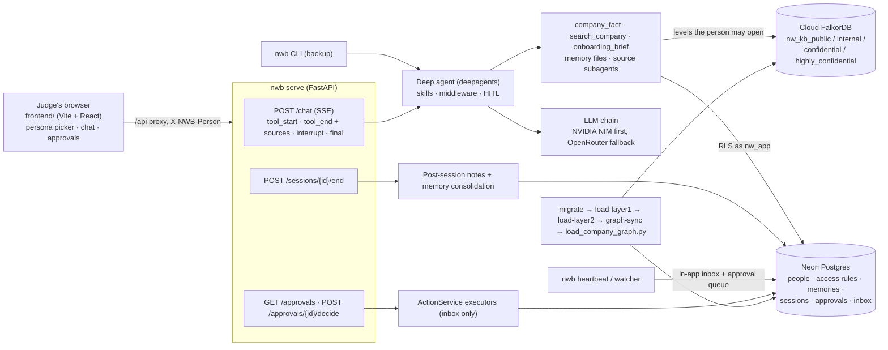

# Judge's demo (about 10 minutes)

FalkorDB Graph Hacks, **Track 3 (Company Brain)**, **Track 2 (Agent Memory)** and **Track 1 (Agents That Act on Connected Data)**. Northwind Consulting is a
fictional company; all data is synthetic.

## The problem (1 minute)

A consulting company's knowledge sits in HR files, pricing approvals, contracts and policies. People can't
find it, and an assistant that can find it will leak it. Northwind Brain answers company questions **as the
person asking**:

- It reads only the graph levels that person may open (public, internal, confidential, highly confidential).
- It answers with the value that was true on the as-of date, and cites the record it came from.
- It remembers each person across sessions.
- It nudges on a schedule (heartbeat).
- Every side effect waits for a human approval.

## Architecture



## Before the demo

Neon has been migrated and loaded, and cloud FalkorDB has its graphs. Two processes are left running:

```bash
# API (.env + var/demo.env: Neon pooler as nw_app, cloud FalkorDB, NVIDIA)
(set -a; . ./.env; . var/demo.env; set +a; export NWB_MIGRATE_URL="$NEON_DIRECT_URL"; .venv/bin/nwb serve --host 127.0.0.1 --port 8000)
# UI
cd frontend && npm ci && npx vite --host 127.0.0.1 --port 5173 --strictPort
```

Open **http://127.0.0.1:5173/**. `GET /health` reports FalkorDB reachable, postgres reachable, and
llm `nvidia/nemotron-3-super-120b-a12b` authenticated.

## Click-through (as a first-time judge)

| # | Time | Persona (picker) | Do | Expect | Shows |
|---|------|------------------|----|--------|-------|
| 1 | 0:00 | — | Open the page, open the persona picker (nobody is preselected) | 7 Northwind people, each with a role | T3: identity drives access |
| 2 | 1:00 | **NW1101** Siddharth Chauhan (DM, Brightmart) | Ask *What discount did we finally approve for Brightmart?* | "The final approved discount for Brightmart UK plc is **18%**", cited `[approvals/pricing_exceptions:PEX-2026-004]`. The Evidence panel shows the FalkorDB evidence and a reasoning graph: graph `nw_kb_highly_confidential`, node `(:Fact {id: …})`, the `MATCH` that read it. About 30 s. | T3: graph-backed, cited, as-of answer |
| 3 | 2:30 | **NW1103** Nikhil Bose (PM, same account) | Ask the same question | "This is not on record for you. Ask Siddharth Chauhan, your manager, or the document owner." No figure, and no hint that one exists. About 25 s. | T3: per-person access on the same graph |
| 4 | 4:00 | **NW2027** Omkar Bhat (new hire) | *Hi, I'm new here. What should I focus on this week?* | Day 34, phase p3. Names manager Alok Naik and buddy Komal Karnik, then lists 6 overdue items in order. | T3: onboarding from HR records |
| 5 | 5:30 | **NW2075** Alok Naik (Omkar's manager) | Look at the Approvals panel | `Overdue onboarding: Omkar Bhat` (escalate_onboarding, requested via watcher). | T3: proactive watcher + heartbeat |
| 6 | 6:30 | NW2075 | Click **Approve** | Status changes. The executor writes in-app inbox messages only; nothing leaves the system. | Human-in-the-loop action |
| 7 | 7:15 | — | Wrap up | One API, four classification graphs, row-level security in Postgres, memory per person | |

## CLI backup (with trimmed real outputs, Sun 18 Oct 2026, IST)

Full outputs are in `var/demo-run/` (gitignored). Every command runs with
`(set -a; . ./.env; . var/demo.env; set +a; export NWB_MIGRATE_URL="$NEON_DIRECT_URL"; …)`.
Secrets stay in `.env` and are never printed.

**1. Migrate Neon** (owner direct URL: `DATABASE_URL="$NEON_DIRECT_URL" .venv/bin/nwb migrate`)
```
migrate migration=0018_drop_sql_memory.pg.sql dialect=postgres
migrate migration=0019_drop_facts.pg.sql dialect=postgres
applied 20 migration(s): 0001_core.sql, … 0021_session_checks.pg.sql
applied 1 migration(s): 0022_owner_assumes_app_role.pg.sql
```
Neon was empty before this run, so 0018/0019 had no SQL memories or facts to copy and printed no `copied:` lines.

**2. Load SQL layers and sync the graph**
```
$ nwb load-layer1
Layer1Report(units=15, people=3002, memberships=3671, reporting_lines=3006, groups=22, group_members=4026, access_rules=13, skipped_lines=0)
$ nwb load-layer2
Layer2Report(records_written=4125, documents_written=48, grants=7090, facts={'current': 8}, rejected=0, clients=6, extracted_docs=0)
$ nwb graph-sync
SyncReport(processed=25019, failed=0, pending=0)        # about 95 s
```

**3. Company graphs on cloud FalkorDB** (`PYTHONPATH=src:. .venv/bin/python scripts/load_company_graph.py --llm live --prefix "" --max-prose 1 --max-rows 200`)
```
internal             nw_kb_internal             entities=366 edges=1261
confidential         nw_kb_confidential         entities=103 edges=209
highly_confidential  nw_kb_highly_confidential  entities=83  edges=201
"llm": "nvidia:nvidia/nemotron-3-super-120b-a12b", "live_verified": true
```
The load is sliced for the demo, because the full prose load takes about 2 minutes per document on the free
tiers, and a 3,000-row edge stamp timed out on cloud FalkorDB.

**4. Same question, two personas** (`nwb ask --as NW1101 "What discount did we finally approve for Brightmart?"`, or via the API)
```
NW1101  tool> company_fact {"client": "Brightmart"}   drew from> highly_confidential: approvals/pricing_exceptions:PEX-2026-004
        brain> The discount finally approved for Brightmart is 18 % (approval PEX-2026-004). [done · 22913 ms]
NW1103  tool> company_fact {"client": "Brightmart"}
        brain> I don't have a record of the discount finally approved for Brightmart for you. Please ask your manager,
               Siddharth Chauhan, or the document owner. [done · 23973 ms]
```

**5. Onboarding** (`nwb ask --as NW2027 "Hi, I'm new here. What should I focus on this week?"`)
```
tool> onboarding_brief {"focus": "all"}
brain> You're on day 34 of your onboarding (phase p3). Your manager is Alok Naik (NW2075) and your onboarding buddy is
       Komal Karnik (NW2015). All of your assigned onboarding items are currently overdue … 1. Activate SSO, MFA … [done · 43993 ms]
```

**6. One heartbeat tick** (`nwb heartbeat --at 2026-09-28T10:00:00+05:30 --asof 2026-09-28`)
```
HeartbeatReport(at=2026-09-28 10:00+05:30, skipped=None, sent=['NW2027', 'NW2140', … 45 people], silent=[], deduped=[])
```
"Sent" means in-app inbox messages, deduplicated per day.

**7. Approval** (`nwb watcher --asof 2026-09-28`, then `nwb approvals --as NW2075`, then `nwb approvals --as NW2075 --decide <id> approve`)
```
watcher 2026-09-28: proposed 48, already queued 0, skipped 0
apr-76ec788a51b3  escalate_onboarding  Overdue onboarding: Omkar Bhat  (requested by NW2027, via watcher:overdue_onboarding)
1 pending
```
Approve it in the UI as NW2075. The CLI `--decide` is the backup.

## Known limits

- Aditi Verma (Finance, NW0201) also sees 18%: `grp-finance` is on PEX-2026-004's ACL. It is a second grant,
  not a leak; NW1101 and NW1103 are the clearer pair for the access demo.
- A turn takes 20–50 s on the free NVIDIA tier. While it works, the chat shows a plain-language step and a timer.

## Automated UI check

`scripts/demo_ui_check.py` drives this click-through in headless Chromium and checks each answer
(`demo/ui_check.yaml`). Screenshots go to `var/demo-run/ui/`. It makes live LLM calls and approves the pending
approval, so requeue one afterwards with `nwb watcher --asof <a later Monday>`. `--reset` first removes any bullet preference earlier runs saved for NW0301, so her memory starts clean.

```bash
uv pip install --python .venv/bin/python playwright
PLAYWRIGHT_BROWSERS_PATH=var/ms-playwright .venv/bin/python -m playwright install chromium-headless-shell
PLAYWRIGHT_BROWSERS_PATH=var/ms-playwright PYTHONPATH=src .venv/bin/python scripts/demo_ui_check.py --reset [--only 02_siddharth_discount]
```

`--record` films the same run at 1920x1080 (typed questions, a pause on each result, a close-up of the
Evidence panel, with the reasoning graph, after step 2) and cuts it into the clips named in `record.clips` (c01 Siddharth, c01z evidence close-up, c02 Nikhil, c03 Omkar, c06 Alok)
in `var/demo-run/video/`: `<clip>.webm`, plus `<clip>.mp4` when `imageio-ffmpeg` is in the .venv
(`uv pip install --python .venv/bin/python imageio-ffmpeg`). `clips.json` lists each clip's length and the
start/end seconds of every model wait, for trimming.
